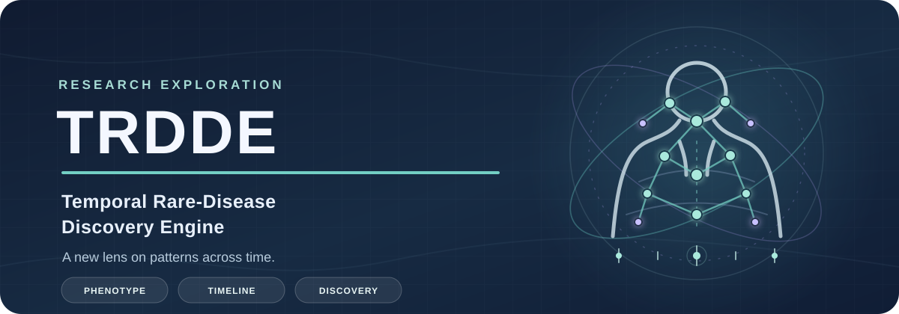

<p align="center">
  
</p>

<p align="center">
  <strong>Find patterns. Ask better questions.</strong><br>
  An educational Python prototype for exploring multisystem feature overlap and illustrative onset intervals.
</p>

<p align="center">
  <a href="https://github.com/krlhsn/trdde-rare-disease-discovery/actions/workflows/tests.yml"></a>
  
  
  
  
</p>

---

## Overview

The **Temporal Rare-Disease Discovery Engine (TRDDE)** is a research-exploration prototype built to investigate a computational question:

> Can comparing combinations of features across body systems, while considering their reported timing, help formulate new questions for rare-disease research?

TRDDE represents observations as feature identifiers and onset-age intervals. It compares fictional profiles, ranks candidate overlaps, and turns selected patterns into structured research questions. The project is designed to make its assumptions and limitations visible rather than presenting exploratory scores as medical evidence.

## What it does

| Component | Purpose |
|---|---|
| Cohort-level discovery | Compares every unique profile pair and ranks candidate multisystem overlaps. |
| Temporal profile explorer | Displays a profile's illustrative onset-age intervals. |
| Profile comparison | Shows shared features, system labels, similarity, and interval relationships. |
| Hypothesis dossiers | Converts candidate overlaps into cautious research questions and suggested validation steps. |
| Research question builder | Creates an exploratory question from two selected features. |
| Data-quality summary | Reports the size and interval coverage of the synthetic demonstration cohort. |
| JSON report export | Writes a structured report containing methods, profiles, candidates, hypotheses, and limitations. |

## Quick start

**Requirements:** Python 3.10 or newer. TRDDE uses only the Python standard library; no package installation is required.

Run the interactive program:

```bash
python main.py
```

Run a dataset integrity check:

```bash
python main.py --validate
```

Print the ranked cohort summary:

```bash
python main.py --summary
```

Export a JSON report to the default filename:

```bash
python main.py --export
```

Choose a custom report path:

```bash
python main.py --export reports/trdde-report.json
```

Run the automated test suite:

```bash
python -m unittest discover -s tests -v
```

## How the prototype ranks profile pairs

### 1. Feature representation

Each fictional profile contains feature IDs and an illustrative onset-age interval. IDs beginning with `SYN-` are local demonstration identifiers. They are **not** Human Phenotype Ontology (HPO) identifiers.

### 2. Inverse-frequency weighted Jaccard similarity

Features that occur in fewer profiles receive higher cohort-relative weights. For profile feature sets $A$ and $B$, the weighted Jaccard score is:

$$
J_w(A,B)=\frac{\sum_{f\in A\cap B}w_f}{\sum_{f\in A\cup B}w_f}
$$

This measures weighted feature-set overlap in the supplied demonstration cohort. It is not a clinical importance score.

### 3. Temporal interval compatibility

For each feature shared by a pair, the prototype checks whether the two illustrative onset-age intervals overlap. Temporal compatibility is the fraction of shared features with overlapping intervals. An overlap does not establish event order, causation, or a shared biological mechanism.

### 4. Combined exploratory ranking

The current ranking combines the two quantities:

$$
S=0.70J_w+0.30T
$$

where $J_w$ is weighted phenotype similarity and $T$ is temporal interval compatibility. A candidate pair must share at least two features represented by at least two system labels.

The weights and candidate rule are transparent design choices for this prototype, not clinically validated thresholds.

## Demonstration dataset

The built-in dataset contains:

- 10 fictional profiles
- 20 synthetic feature types
- 50 illustrative feature observations
- 13 broad system labels represented among the features

Every profile and observation is fictional. The complete demonstration dataset is embedded in `main.py`, so the program does not need network access, external files, database credentials, or patient uploads.

## Project structure

```text
trdde-rare-disease-discovery/
├── .github/
│   └── workflows/
│       └── tests.yml       # Automated checks on GitHub
├── assets/
│   └── trdde-banner.svg    # Repository banner
├── tests/
│   └── test_trdde.py       # Standard-library unit tests
├── .gitignore
├── CITATION.cff
├── LICENSE
├── README.md
└── main.py                 # Application, data, and analysis methods
```

## Testing and continuous integration

The test suite checks dataset integrity, expected demonstration-data dimensions, weighted Jaccard behavior, interval overlap, profile comparisons, candidate-generation rules, hypothesis status, report structure, and JSON export.

A GitHub Actions workflow runs validation, tests, and an export check on pushes and pull requests targeting `main`. It checks Python 3.10 through 3.14. The workflow is a software-quality check; it does not validate biomedical assumptions or clinical usefulness.

## Limitations and responsible use

**TRDDE v1.1.0 is an educational research prototype, not a diagnostic or clinical decision-support tool.**

- The built-in dataset is entirely synthetic; there are no real patient records or disease annotations.
- There is no live HPO, Orphanet/Orphadata, Monarch, Phenopackets, or literature integration in this version.
- The feature and interval definitions are illustrative and have not been clinically validated.
- Similarity and temporal compatibility scores are exploratory ranking aids, not probabilities, diagnoses, or evidence of causation.
- Candidate patterns and generated questions require suitable real-world data, expert review, careful statistical analysis, and independent replication before they could support scientific conclusions.

No clinical or personal health decisions should be made using this software.

## Roadmap

The following are possible future research-development directions, not current capabilities:

1. Add documented, versioned mappings to established phenotype vocabularies.
2. Design validated import pipelines for properly licensed, de-identified, and ethically governed biomedical datasets.
3. Represent missingness, uncertainty, provenance, and differing evidence quality explicitly.
4. Evaluate ranking behavior against baselines and independent datasets.
5. Add reproducible literature-evidence links and expert-review workflows.
6. Assess bias, cohort ascertainment, confounding, and sensitivity to parameter choices.

## Reproducibility

The built-in data, analysis rules, and tests are included in this repository. The JSON export records the version, method descriptions, feature observations, candidate pairs, hypotheses, and limitations so a demonstration run can be inspected later.

## Author

**Kamrul Hassan**  
[GitHub](https://github.com/krlhsn) · [LinkedIn](https://www.linkedin.com/in/krlhsn/) · [ORCID](https://orcid.org/0009-0008-2990-1036)

## License

This project is released under the [MIT License](LICENSE).

---

<p align="center"><em>Patterns are questions. Evidence moves science forward.</em></p>
